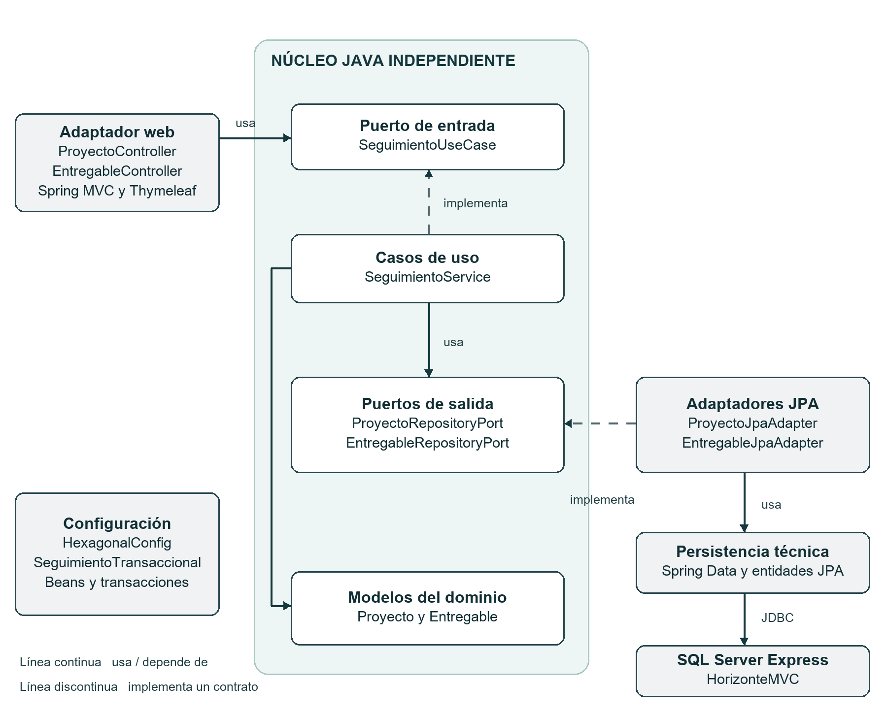
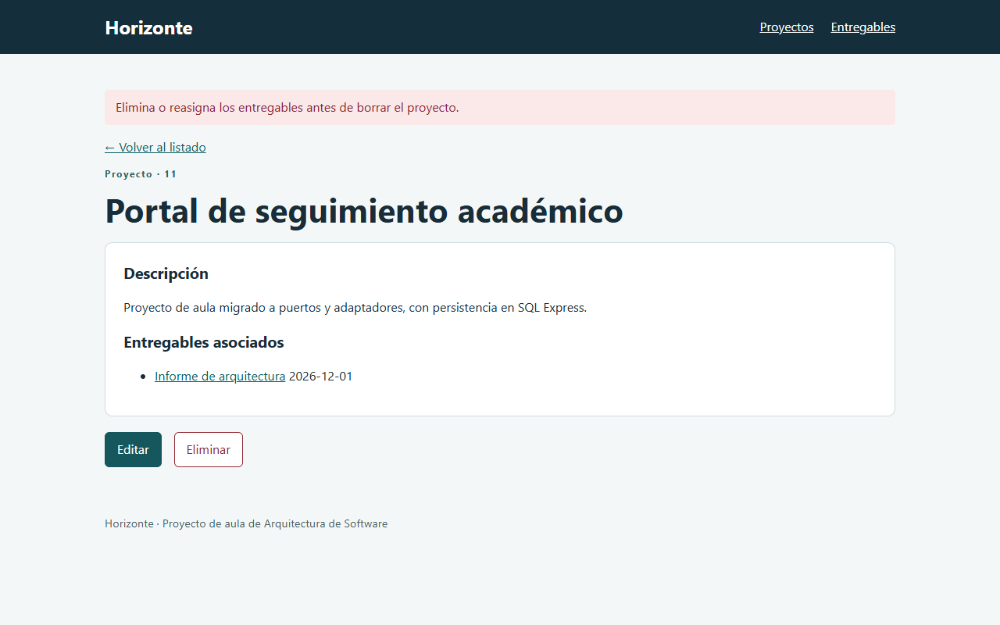

# Horizonte con arquitectura hexagonal

Proyecto de aula de **Santiago Gasca Aristizabal**, Arquitectura de Software, Institución Universitaria Pascual Bravo. Gestiona proyectos académicos y entregables relacionados, con ambos CRUD completos y SQL Server Express.

**Esta entrega está en la rama `arquitectura-hexagonal`. La rama `main` conserva la versión MVC anterior.**

## Documentos de la entrega

- [Documento técnico PDF](docs/Documento-Tecnico-Horizonte-Hexagonal.pdf) · [Word editable](docs/Documento-Tecnico-Horizonte-Hexagonal.docx)
- [Manual del sistema PDF](docs/Manual-Horizonte-Hexagonal.pdf) · [Word editable](docs/Manual-Horizonte-Hexagonal.docx)
- [Resultados de verificación](docs/Verificacion.md)
- [Capturas posteriores a la migración](docs/capturas)



## Organización

| Paquete | Responsabilidad |
| --- | --- |
| `domain.model` y `domain.exception` | Modelos Java puros y errores propios. |
| `domain.port.in` | `SeguimientoUseCase`, contrato de entrada. |
| `domain.port.out` | Dos contratos de persistencia. |
| `application.service` | `SeguimientoService`, reglas y coordinación sin Spring/JPA. |
| `infrastructure.adapter.in.web` | Controladores Spring MVC y formularios Thymeleaf. |
| `infrastructure.adapter.out.persistence` | Adaptadores, entidades JPA, mapeador y repositorios Spring Data. |
| `infrastructure.config` | Ensamblaje y decorador de transacciones. |

Los controladores usan el puerto de entrada; los adaptadores JPA implementan los puertos de salida. Spring MVC permanece dentro del adaptador web. El dominio y el servicio no conocen HTTP, SQL ni JPA.

## Obtener y ejecutar

Requisitos: JDK 21, Maven 3.9, SQL Server Express y una base `HorizonteMVC` accesible.

```powershell
git clone --branch arquitectura-hexagonal https://github.com/santiago0114gascaaristizabal-del/horizonte-mvc.git
cd horizonte-mvc
java -version
mvn -v
```

1. Verifica que SQL Express esté iniciado. La conexión comprobada utiliza `127.0.0.1:14333`. Si tu instancia tiene otro puerto, adapta la URL. No necesitas reiniciar una instancia que ya funciona.
2. En una instalación nueva, ejecuta `sql/01-crear-base.sql` en SSMS con una cuenta autorizada. En una base existente, conserva tablas y datos y comprueba el esquema. La aplicación lo valida, no lo crea ni modifica.
3. Usa una cuenta SQL propia asociada a `HorizonteMVC`. Un administrador puede crear `horizonte_app`, asignarle usuario en esa base y ejecutar `sql/02-permisos-aplicacion.sql`. Cambia el usuario del script si corresponde. La instancia debe permitir autenticación SQL.
4. Prepara la configuración local y sustituye los valores de ejemplo por tu conexión y credenciales:

   ```powershell
   New-Item -ItemType Directory -Force config
   Copy-Item conexion-local.example.properties config/application.properties
   ```

5. Compila e inicia desde la raíz del proyecto:

   ```powershell
   mvn clean package
   java -jar .\target\horizonte-mvc-1.0.0.jar
   ```

6. Espera `Started HorizonteApplication` y abre [http://127.0.0.1:8080/](http://127.0.0.1:8080/). Detén con Ctrl+C. Si 8080 está ocupado, añade `--server.port=18081` al comando de Java y abre ese puerto.

El archivo `/config/application.properties` queda fuera de Git y del ZIP. Ningún archivo distribuido contiene credenciales reales. `HORIZONTE_DB_URL`, `HORIZONTE_DB_USER` y `HORIZONTE_DB_PASSWORD` permiten configurar sin archivo local; `HORIZONTE_PORT` cambia el puerto web. `trustServerCertificate=true` corresponde al ejercicio local. La conexión SQL utilizada no requiere DLL de autenticación integrada.

## Uso

En **Proyectos**, crea nombre y descripción. En **Entregables**, registra título, fecha y proyecto asociado. Los listados permiten consultar y editar. Desde el detalle puedes eliminar; si el proyecto tiene entregables, debes eliminarlos o reasignarlos antes. Rutas: `/`, `/proyectos` y `/entregables`.



## Verificación

```powershell
mvn test
```

**12 pruebas**: 3 del caso de uso con memoria, 3 de integración web con H2, 2 de arquitectura y 4 de infraestructura. Una compila el núcleo solo con el JDK, sin Spring/JPA. Las pruebas cargan explícitamente el classpath para evitar tomar la conexión SQL local.

Se comprobó además el ejecutable contra SQL Express en el navegador: CRUD, reasignación, validación, bloqueo y 404. Solo se retiraron los registros de esa comprobación y se conservaron los identificadores previos. Una copia limpia exportada desde Git también compiló y pasó las 12 pruebas.

## Alcance y referencias

Prototipo académico local sin autenticación, roles, carga de archivos ni despliegue público. Mantiene campos, tablas y reglas del MVC. Sustituir persistencia requiere adaptar infraestructura y migrar datos.

- Actividad y guía de migración de la asignatura.
- [Cockburn, arquitectura hexagonal](https://alistair.cockburn.us/hexagonal-architecture)
- [Spring MVC y controladores](https://docs.spring.io/spring-framework/reference/6.2/web/webmvc/mvc-controller.html)
- [Transacciones programáticas](https://docs.spring.io/spring-framework/reference/6.2/data-access/transaction/programmatic.html)
- [Microsoft JDBC y conexión](https://learn.microsoft.com/en-us/sql/connect/jdbc/building-the-connection-url)
