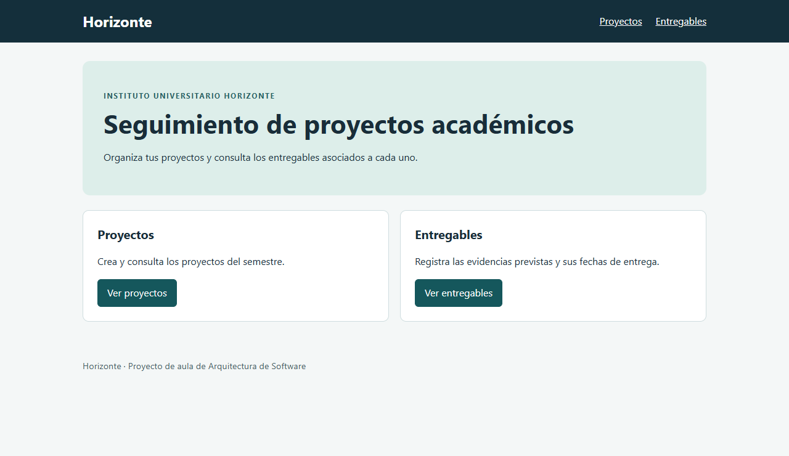

# Horizonte MVC

Aplicación académica local para gestionar **proyectos** y **entregables** relacionados. Estudiante: Santiago Gasca Aristizabal. Arquitectura de Software, Institución Universitaria Pascual Bravo.

## Entrega académica

- [Manual en PDF](docs/Manual-Horizonte-MVC.pdf)
- [Manual editable en Word](docs/Manual-Horizonte-MVC.docx)
- [Capturas de funcionamiento con SQL Server Express](docs/capturas)



## Organización MVC

| Carpeta | Responsabilidad |
| --- | --- |
| `src/main/java/edu/horizonte/modelo` | Entidades Proyecto y Entregable; relación uno a muchos. |
| `src/main/java/edu/horizonte/controlador` | Rutas web y validación de formularios. |
| `src/main/java/edu/horizonte/servicio` | Reglas de negocio y operaciones transaccionales. |
| `src/main/java/edu/horizonte/repositorio` | Acceso a datos mediante Spring Data JPA. |
| `src/main/resources/templates` | Vistas Thymeleaf: formularios, listados y detalles. |
| `sql` | Creación de la base y permisos de la aplicación. |
| `src/test` | Pruebas automatizadas con base H2 aislada. |

El código incluye CRUD para ambas entidades. Un proyecto con entregables asociados no puede eliminarse hasta eliminar o reasignar sus entregables.

## Ejecutar en Windows

1. Instala un JDK 21 de 64 bits y Maven 3.9. Verifica con `java -version` y `mvn -v`.
2. Usa SQL Server Express y una cuenta de Windows con acceso a la instancia y permisos para crear la base. En SQL Server Configuration Manager, habilita TCP/IP para `SQLEXPRESS`. Para un entorno local, configura **Listen All = No**, habilita la entrada de `127.0.0.1`, deja vacío **TCP Dynamic Ports** y asigna **TCP Port = 14333**. Si tienes otro puerto habilitado, usa ese en `HORIZONTE_DB_URL` en vez de cambiar el servidor. Un cambio de protocolo o puerto exige reiniciar el servicio; coordínalo si hay conexiones activas.
3. En SSMS, con autenticación de Windows, abre y ejecuta `sql/01-crear-base.sql`. O, desde la carpeta del proyecto:

   ```powershell
   sqlcmd -S "tcp:127.0.0.1,14333" -E -C -b -i "sql/01-crear-base.sql"
   ```

4. En SSMS crea un inicio de sesión de **autenticación SQL Server** llamado, por ejemplo, horizonte_app. Elige tu propia contraseña y, en Asignación de usuarios, marca HorizonteMVC. Ejecuta sql/02-permisos-aplicacion.sql para darle permisos CRUD exclusivamente sobre las dos tablas. Si eliges otro nombre, cambia el nombre del usuario en ese script.
5. Crea la carpeta config en la raíz de este proyecto y copia conexion-local.example.properties con el nombre config/application.properties. Reemplaza las credenciales de ejemplo por las tuyas. Esta configuración local no se versiona ni se incluye en el ZIP. En el equipo de Santiago ya está preparada: no hay que crear otra cuenta.
6. Desde la carpeta horizonte-mvc, ejecuta:

   ```powershell
   mvn clean package
   java -jar target/horizonte-mvc-1.0.0.jar
   ```

7. Abre http://127.0.0.1:8080/. Para detener el servidor, presiona Ctrl+C.

La aplicación escucha solo en 127.0.0.1. Spring carga la conexión de config/application.properties. El archivo distribuido no contiene contraseñas reales. El puerto SQL de referencia es 14333 y la base debe existir previamente. La opción trustServerCertificate=true corresponde al ejercicio local. HORIZONTE_DB_URL, HORIZONTE_DB_USER y HORIZONTE_DB_PASSWORD son alternativas mediante variables de entorno cuando no se usa el archivo local. HORIZONTE_PORT cambia el puerto web.

La autenticación SQL no requiere la DLL de autenticación integrada. Si una instalación utiliza Windows, puede configurarse integratedSecurity=true con la biblioteca oficial apropiada, pero esa no es la conexión validada en este computador.

## Uso

En **Proyectos**, crea uno con nombre y descripción. Luego, en **Entregables**, registra un título, fecha límite y el proyecto asociado. Los listados ofrecen **Consultar** y **Editar**; cada detalle ofrece **Eliminar**. Elimina o reasigna los entregables antes de borrar su proyecto.

## Pruebas

`mvn test` verifica los CRUD, los formularios, el vínculo y las validaciones en H2 aislada. La aplicación se verificó además en el navegador contra SQL Server Express con autenticación SQL y permisos CRUD limitados. No uses una base con datos de trabajo como destino de la configuración de pruebas: esta crea y elimina su esquema.

## Fuentes técnicas

- [Spring Boot: requisitos de la versión 3.5](https://docs.spring.io/spring-boot/3.5/system-requirements.html)
- [Spring: servir vistas con MVC y Thymeleaf](https://spring.io/guides/gs/serving-web-content)
- [Microsoft: URL JDBC y autenticación integrada](https://learn.microsoft.com/en-us/sql/connect/jdbc/building-the-connection-url)
- [Microsoft: configurar un puerto TCP específico](https://learn.microsoft.com/en-us/sql/database-engine/configure-windows/configure-a-server-to-listen-on-a-specific-tcp-port)
